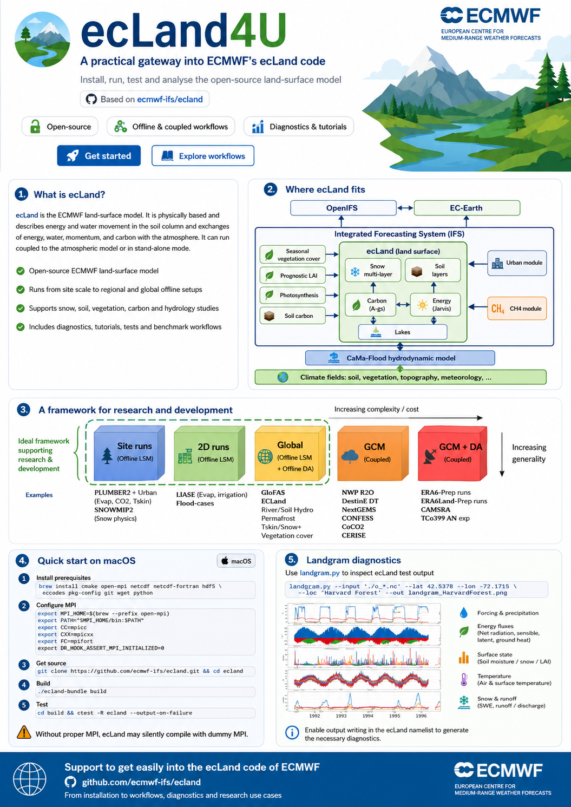

# ecLand4U

<p align="center">
  
</p>

**ecLand4U** is a practical gateway into ECMWF's open-source ecLand code.

It supports users who want to install, run, test and analyse ecLand, with examples for:

- macOS installation
- MPI configuration
- ecLand build and tests
- site and offline workflows
- landgram diagnostics
- research and development use cases

The project is based around the official ECMWF ecLand repository:

https://github.com/ecmwf-ifs/ecland

## Purpose

The goal of **ecLand4U** is to make it easier for students, researchers, PhD candidates, postdocs and collaborators to get started with ecLand, from installation to first experiments and diagnostics.

The material is intended as a practical support layer around the official ecLand codebase, with a focus on:

- reproducible installation notes;
- simple workflows for running ecLand;
- practical diagnostics and plotting;
- research-to-operation examples;
- land, snow, vegetation, carbon and hydrology use cases.

## Getting started: Configure the macOS build environment

Before building ecLand on macOS, use a clean Python virtual environment and configure MPI explicitly.  
This avoids problems with `conda base`, Homebrew Python's externally managed environment, and the `field_api` dependency requiring `fypp`.

### 1. Deactivate conda if active

```bash
conda deactivate 2>/dev/null || true
conda deactivate 2>/dev/null || true
```

### 2. Create a Python virtual environment for ecLand build tools

```bash
python3 -m venv ~/Work/ecland_venv
source ~/Work/ecland_venv/bin/activate

python -m pip install --upgrade pip
python -m pip install fypp
```

Check that the virtual environment is active:

```bash
which python
which fypp
python --version
```

You should see paths similar to:

```text
/Users/<user>/Work/ecland_venv/bin/python
/Users/<user>/Work/ecland_venv/bin/fypp
```

### 3. Configure MPI explicitly

```bash
export PYTHONNOUSERSITE=1

export MPI_HOME=$(brew --prefix open-mpi)
export PATH="$MPI_HOME/bin:$PATH"

export CC=mpicc
export CXX=mpicxx
export FC=mpifort

export DR_HOOK_ASSERT_MPI_INITIALIZED=0
```

### 4. Clone ecLand

```bash
cd ~/Work
git clone https://github.com/ecmwf-ifs/ecland.git
cd ecland
```

If you already cloned ecLand and want a clean rebuild:

```bash
cd ~/Work/ecland
rm -rf build source install
```

### 5. Create and build the ecLand bundle

```bash
./ecland-bundle create

./ecland-bundle build \
  --cmake="Python3_EXECUTABLE=$(which python);FYPP=$(which fypp)"
```

The `create` step downloads all dependencies defined by the ecLand bundle, including `field_api`.

### 6. Install

```bash
./build/install.sh --fast
```

### 7. Test ecLand

```bash
cd ~/Work/ecland/build
. ./env.sh

ctest -L ecland --output-on-failure
```

Avoid using plain `ctest` as a first check, because it also runs tests for bundled dependencies such as ecCodes, fiat and field_api.

### 8. Debug build

For a debugger-friendly build, disable OpenMP and tests first:

```bash
cd ~/Work/ecland

source ~/Work/ecland_venv/bin/activate
export PYTHONNOUSERSITE=1

export MPI_HOME=$(brew --prefix open-mpi)
export PATH="$MPI_HOME/bin:$PATH"

export CC=mpicc
export CXX=mpicxx
export FC=mpifort

export DR_HOOK_ASSERT_MPI_INITIALIZED=0

rm -rf build source install

./ecland-bundle create

./ecland-bundle build \
  --build-type=Debug \
  --without-omp \
  --without-tests \
  --cmake="Python3_EXECUTABLE=$(which python);FYPP=$(which fypp);ECBUILD_Fortran_FLAGS=-g -O0 -fcheck=all -fbacktrace"
```export MPI_HOME=$(brew --prefix open-mpi)
export PATH="$MPI_HOME/bin:$PATH"

export CC=mpicc
export CXX=mpicxx
export FC=mpifort

export DR_HOOK_ASSERT_MPI_INITIALIZED=0
```
Then build ecLand:
```bash
./ecland-bundle create
./ecland-bundle build
```
Run the ecLand tests:
```bash
cd build
ctest -R ecland --output-on-failure
```

Landgram diagnostics
The landgram.py diagnostic can be used to inspect ecLand test output, which runs as an example the Harvard Forest site :

```bash
landgram.py \
  --input "./o_*.nc" \
  --lat 42.5378 \
  --lon -72.1715 \
  --loc "Harvard Forest" \
  --out landgram_HarvardForest.png
```
Make sure the ecLand namelist enables output writing before running the Landgram diagnostics.

## Repository structure

```text
docs/        Documentation and user guides
notebooks/   Interactive examples and diagnostics
scripts/     Command-line utilities
examples/    Ready-to-run ecLand use cases
assets/      Images and visual material for the README and documentation
```

## Next steps

- Run the [PLUMBER2 with ecLand](https://github.com/gpbalsamo/plumber2-ecland).
- Run the [LIAISE with ecLand](https://github.com/gpbalsamo/liaise-ecland).
- Run the [WFDE5 global run with ecLand + CaMa-Flood](https://github.com/gpbalsamo/globoland-hydro/tree/main/ecland).


## Status
This repository is under active development. Feedback welcome.

